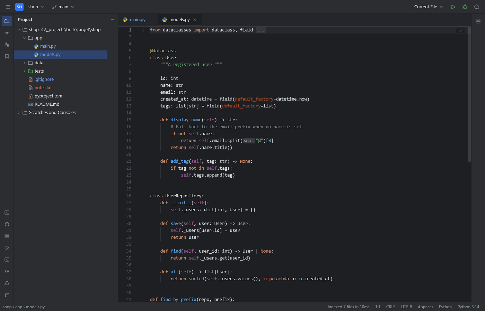

<p align="center">
  
</p>

<h1 align="center">Brisk IDE: a lightweight, open-source PyCharm alternative</h1>

<p align="center">
  A fast, native Python IDE written in Rust, for developers who like the PyCharm workflow
  but not the sound of their laptop fan.
</p>

<p align="center">
  <a href="https://github.com/thirisnospoon/brisk/releases/latest"></a>
  
  
</p>

<p align="center">
  <b><a href="https://github.com/thirisnospoon/brisk/releases/latest">Download for Windows</a></b>
  · <a href="docs/features.md">Features</a>
  · <a href="#frequently-asked-questions">FAQ</a>
  · <a href="docs/building.md">Build from source</a>
</p>

Brisk IDE is a free, open-source Python IDE. It keeps PyCharm's window layout, default
keymap and action names, so your habits carry over, and it is written from scratch
in Rust on [GPUI](https://www.gpui.rs/), the GPU-rendered UI framework behind the Zed
editor. The IDE is a single 26 MB executable, starts in under half a second, and the IDE
process itself uses about 65 MB of memory while idle (the ty and ruff helpers run as
separate processes; [details](#performance-and-memory-usage)). Probably less than the
browser tab you are reading this in.

> [!WARNING]
> **Brisk is in early development (version 0.3.x) and still raw.** Expect bugs, missing
> features and rough edges. Only Windows builds exist. Settings and file formats may
> change between versions. The full list of gaps is in
> [What it does not do (yet)](#what-it-does-not-do-yet).
> Bug reports are very welcome: [open an issue](https://github.com/thirisnospoon/brisk/issues).
> It is raw. Not "rare steak" raw, more "the oven was just turned on" raw.

Raw, but already useful: you can write, run, test and debug real Python in it. The best
time to try it is now, while your bug report still changes the plan instead of landing in
a backlog of 4,000 issues. Star the repository so you do not lose it, or click **Watch →
Custom → Releases** to hear when a new version is out.



## Why Brisk?

Full IDEs are great at Python. They also bring a JVM or a browser engine, hundreds of
megabytes of memory before you open a file, and background indexing you can hear from the
next room through the laptop fan. Lightweight editors start instantly, and then you spend
an evening assembling twelve extensions and learning new shortcuts.

Brisk aims at the middle:

- **Native and small.** Compiled Rust, no JVM, no Electron, no installer. One
  executable plus the Python tools it drives.
- **Familiar.** PyCharm's layout, keymap (Ctrl+B, Shift+F6, Alt+Enter, double Shift
  and the rest), run configurations and tool windows. It can import your existing
  `.idea` run configurations.
- **Python first.** Completion, navigation, inspections, refactoring, the debugger,
  test runners and the package manager are built in and work out of the box.
- **Measured.** Size, startup time and memory are checked against fixed limits on
  every merge (see below). If the IDE gets fatter, CI notices before you do.

Brisk is an independent project and is not a copy of PyCharm's code. It reproduces
behaviour and shortcuts; the code, icons and artwork are its own.

## Performance and memory usage

Measured with `cargo xtask budget` on Brisk 0.4.0 (release build), Windows 11 Pro,
AMD Ryzen 7 7735HS, 28 GB RAM, opening the bundled `examples\demo_project`. Every
launch uses a fresh settings folder. Numbers are working sets unless noted.

| Metric | Brisk 0.4.0 | Limit checked on every merge |
|---|---|---|
| `brisk.exe` size | 22.0 MB | 26 MB |
| Portable zip (with ty, ruff, debugpy) | 37.4 MB | 39 MB |
| Startup, process start to first frame with the project open (median of 9) | 0.46 s | 0.4 s |
| IDE process, idle, 5 s after start | 67 MB (87 MB private) | 110 MB |
| IDE process after a heavy session: 200k lines of run output, 50 tabs, Find in Files | 85 MB | 200 MB |
| ty language server, peak during that session (separate process) | 95 MB | not checked |
| ruff, peak during that session (separate process) | 16 MB | not checked |
| Frame time while scrolling large lists (20k files, 10k variables, 2k commits) | under 10 ms | p95 16 ms |

What these numbers do and do not say:

- The IDE process and its helpers are reported separately. ty (types, completion,
  navigation) and ruff (inspections, formatting) run as child processes. Their memory
  grows with the size of your project; the figures above are for a small project.
- Startup still misses its own 0.4 s limit, by 63 ms in this run; most of the time goes
  into loading fonts. 0.3.0 measured 458 ms on the same machine. Yes, we are that petty
  about milliseconds.
- The heavy session went down from 152 MB in 0.3.0 to 85 MB, mostly because the Run
  console now keeps pipe output as plain text instead of a terminal grid.
- Brisk has not been benchmarked against other IDEs here. If you compare, measure on
  your own machine and project.

We wanted a splash screen like PyCharm's: a nice logo, a progress bar, time to make tea.
Sadly, Brisk opens a project in about 0.46 s (463 ms, median of 9 runs), and the splash
would not get its first frame on screen. We are not slowing the IDE down to show it.

## Features

The full list, including the places where Brisk deliberately differs from PyCharm, is in
[docs/features.md](docs/features.md). In short:

**Editing**
- Multiple carets and column selection, Extend Selection (Ctrl+W), smart Enter and
  paste, Join Lines, folding, sticky lines, soft wraps.
- Live templates and postfix completion, Local History, scratch files.

**Code insight** (through [ty](https://github.com/astral-sh/ty) and [ruff](https://github.com/astral-sh/ruff))
- Completion with auto-import, Go to Declaration (Ctrl+B), Go to Type Declaration,
  Find Usages, Quick Documentation, Parameter Info, inlay type hints.
- Inspections with Alt+Enter quick fixes, Optimize Imports, Reformat Code (also on save).

**Navigation and refactoring**
- Search Everywhere (double Shift), Go to File / Class / Symbol, File Structure,
  Recent Files and Locations, bookmarks.
- Rename (in place, or project-wide with a preview), Extract Variable / Constant /
  Method, Inline, Generate (`__init__`, `__repr__`, `__eq__`, properties),
  Override / Implement Methods, Move Statement, Surround With.

**Running and debugging**
- Run configurations for scripts, modules, pytest, unittest, FastAPI, Flask and Django,
  compatible with PyCharm's `.idea/runConfigurations`; gutter run marks.
- Python debugger (debugpy): breakpoints with conditions, exception breakpoints,
  stepping, Smart Step Into, Evaluate, Watches, inline values, Attach to Process,
  View as DataFrame.

**Testing**
- Test tree with rerun of failed tests and test history, coverage, the cProfile profiler.

**Git**
- Commit with partial commits by hunk, diff, three-way merge, annotate (blame), log
  with graph and filters, branches, stash, push and pull, cherry-pick, reset, revert.
  Git runs through your own `git`, so credentials, hooks and LFS work as usual.

**Python environments and tools**
- Interpreter selection and venv creation, Python Packages window, Python Console,
  terminal, Find in Files, TODO, Problems, a database console for SQLite, PostgreSQL
  and MySQL.

### What it does not do (yet)

- Only Python gets full language support. JSON, TOML, YAML, JavaScript, TypeScript,
  HTML and CSS are highlighted, without code insight.
- No plugins, no WSL or Docker interpreters, no Jupyter notebook editor. SSH
  interpreters (on `main`) run code on the host, but debugging, coverage, profiling,
  the Python console and code insight stay local.
- Windows only. GPUI runs on macOS and Linux, but Brisk has not been ported.
- Far fewer features than PyCharm overall. It covers everyday editing, running,
  debugging, testing and Git for a Python project, not everything a full IDE does.

If you need Jupyter, plugins and macOS today, PyCharm is right there, and we will not be
offended. Much.

## Brisk, PyCharm and VS Code compared

A factual comparison of how the three are built and what they cover. It is not a
benchmark.

| | Brisk | PyCharm | VS Code |
|---|---|---|---|
| Built with | Rust, native GPU-rendered UI (GPUI) | Java / Kotlin on the IntelliJ Platform (JVM) | TypeScript on Electron (Chromium, Node.js) |
| Python support | Built in, Python only | Built in | Through extensions (Python, Pylance, debugger) |
| Keymap | PyCharm's default keymap | PyCharm | Its own; keymap extensions exist |
| Debugger, refactoring, Git, test runners | Yes, basic to solid | Yes, extensive | Yes, through extensions |
| Plugins | No | Large marketplace | Large marketplace |
| Remote development | SSH interpreters for runs (on `main`) | Yes | Yes |
| Platforms | Windows 10/11 x64 | Windows, macOS, Linux | Windows, macOS, Linux |
| License | MIT OR Apache-2.0 | Proprietary; free core features, paid Pro | Code - OSS is MIT; Microsoft's builds are proprietary |
| Maturity | Early (0.3.x) | Mature | Mature |

## Download and installation

**Requirements:** Windows 10 or 11, 64-bit. A Python interpreter on the machine to run
and debug code (Brisk does not bundle Python itself).

1. Download `Brisk-<version>-windows-x64.zip` from the
   [latest release](https://github.com/thirisnospoon/brisk/releases/latest).
2. Unpack it anywhere, for example to `C:\Tools\Brisk`.
3. Run `brisk.exe` and open a project folder.

There is no installer and no administrator rights are needed. Settings are stored next
to the executable (portable mode), so the folder can be moved or carried on a USB stick.
The zip already contains [ty](https://github.com/astral-sh/ty),
[ruff](https://github.com/astral-sh/ruff) and
[debugpy](https://github.com/microsoft/debugpy).

Windows SmartScreen will warn you about an unsigned executable from the internet. It is
right to be suspicious; we are just not paying for a code-signing certificate yet. Choose
"More info" → "Run anyway", or build from source and trust only yourself.

### Building from source

You need a stable Rust toolchain (MSVC on Windows) and PowerShell.

```powershell
git clone https://github.com/thirisnospoon/brisk
cd brisk
powershell -ExecutionPolicy Bypass -File scripts\fetch-tools.ps1     # ty and ruff into vendor\tools
powershell -ExecutionPolicy Bypass -File scripts\fetch-debugpy.ps1   # debugpy for the debugger
cargo run --release -p brisk-app -- examples\demo_project
```

`scripts\package-portable.ps1` builds the release zip. See
[docs/building.md](docs/building.md) for details and [docs/testing.md](docs/testing.md)
for the unit and UI smoke tests.

## Who is Brisk for?

- Python developers who know PyCharm's shortcuts and want them in a lighter tool.
- People on laptops or machines with limited memory who need a low-memory Python IDE,
  or who keep several projects and other heavy apps open at once.
- Developers who prefer native desktop applications to Electron or JVM ones.
- Anyone who wants a free, open-source, portable Python IDE they can unpack and run.

If you need Jupyter, plugins, macOS or Linux, it is not there yet.

## Architecture and technology

The UI is one GPUI crate; everything else is a plain Rust library that can be tested
without a window. Language intelligence comes from proven external tools rather than
being re-implemented: [ty](https://github.com/astral-sh/ty) over the Language Server
Protocol, [ruff](https://github.com/astral-sh/ruff) for linting and formatting,
[debugpy](https://github.com/microsoft/debugpy) over the Debug Adapter Protocol, and
[tree-sitter](https://tree-sitter.github.io/) for highlighting and structure. Child
processes live in one Windows Job Object, so nothing outlives the IDE.

| Crate | Purpose |
|---|---|
| `brisk-app` | Window, editor, tool windows, dialogs |
| `brisk-text` | Rope buffer, undo, encodings, smart editing |
| `brisk-syntax` | tree-sitter parsing, highlighting, folding, outline, intentions |
| `brisk-lsp` | ty client (LSP) |
| `brisk-lint` | ruff integration |
| `brisk-dap` | Debug Adapter Protocol client for debugpy |
| `brisk-settings` | User settings and `settings.json` |
| `brisk-run` | Run configurations (including `.idea` import), test runners, output parsing |
| `brisk-git` | Git through the `git` CLI |
| `brisk-project` | Project tree and the fuzzy file index behind Go to File |
| `brisk-search` | Find in Files |
| `brisk-terminal` | ConPTY plus `alacritty_terminal` for VT emulation |
| `brisk-db` | Database console (SQLite, PostgreSQL, MySQL) |
| `brisk-history` | Local History: file revisions and labels |
| `brisk-keymap` | Actions and the PyCharm keymap |
| `brisk-platform` | The OS-specific parts: child processes without console windows, in one Job Object |
| `brisk-vm` | Groundwork for running containers without Docker Desktop (experimental) |

Design notes are in [docs/architecture.md](docs/architecture.md).

## Frequently asked questions

**What is Brisk IDE?**
A lightweight, open-source Python IDE for Windows, written in Rust. It follows
PyCharm's layout, keymap and behaviour.

**Is Brisk a free and open-source PyCharm alternative?**
Yes. It is free and licensed under MIT OR Apache-2.0. It is an alternative for
everyday Python work, not a full replacement for PyCharm (see the next answers).

**Is Brisk lighter than PyCharm? How much RAM does it use?**
The IDE process uses about 60 MB while idle and stayed under 160 MB in a heavy test
session; the ty and ruff helper processes add to that depending on project size (about
110 MB at peak on a small project). We have not published side-by-side measurements
with other IDEs; see [Performance and memory usage](#performance-and-memory-usage).

**Is Brisk written in Rust? Does it use Electron?**
It is written in Rust on GPUI and draws its UI on the GPU. There is no Electron,
browser engine or JVM.

**Does Brisk support Python debugging?**
Yes, through debugpy: breakpoints, conditions, exception breakpoints, stepping,
Evaluate, Watches and Attach to Process.

**Does Brisk support code completion and refactoring?**
Yes. Completion and navigation come from ty; Rename, Extract, Inline, Generate and
other refactorings are built in.

**Can Brisk run on low-end computers?**
It is meant to be a fast Python IDE that is light on memory and CPU, but it has only
been tested on modern hardware so far. Reports from older machines are welcome; we
promise to read them faster than the old machine boots.

**Which operating systems does Brisk support?**
Windows 10 and 11, 64-bit. macOS and Linux are not supported yet.

**Can Brisk replace PyCharm for everyday Python development?**
For everyday editing, running, debugging, testing and Git on a Python project, it is
worth a try today. Start with a side project, not the production hotfix at 2 a.m.

**What are the differences between Brisk and VS Code?**
VS Code is a general-purpose editor on Electron that gets Python support from
extensions. Brisk is a native, Python-only IDE with PyCharm's workflow built in, and
far less mature.

## Roadmap

- **Released:** everything in [docs/features.md](docs/features.md) that is in the
  latest release.
- **New in 0.4.0:** Brisk's own folder picker for Open and New Project; darker consoles;
  a round of speed and memory work (the heavy session from 152 to 85 MB, the exe from
  26 to 22 MB).
- **New in 0.3.0:** uv and Poetry projects; Django, FastAPI and Flask navigation with an
  Endpoints window; SSH interpreters; Mark Directory as; a configurable keymap with
  PyCharm keymap import; animations and a round of interface polish.
- **Next, the basics:** a new-version notice in the app.
- **In progress:** remote debugging and tests over SSH; completion of template and URL
  names.
- **Planned:** WSL and Docker interpreters; Compose services in the Services window and a
  local PostgreSQL with one click; Docker containers without Docker Desktop or WSL
  ([design](docs/design/containers.md)).
- **Idea:** BriskAPI, a FastAPI application generated from a visual model of entities
  and relations, which stays editable visually and by hand: an API in two clicks, three
  if you read the dialog ([design](docs/design/briskapi.md)).
- **Not started:** macOS and Linux builds, plugins.

## Contributing

Issues and pull requests are welcome.

- Bugs and feature requests: [GitHub issues](https://github.com/thirisnospoon/brisk/issues).
  For a bug, include the Brisk version, Windows version and steps to reproduce.
- Code: build with the steps above, run `cargo test --workspace`, and see
  [docs/testing.md](docs/testing.md) for the UI smoke tests. Keep changes inside the
  size and memory budget (`scripts\budget.ps1`).
- Code, comments and docs are in English. Bug reports may be emotional, as long as they
  include steps to reproduce.

## Relationship to JetBrains

Brisk is an independent project and is not affiliated with, endorsed by or sponsored
by JetBrains. PyCharm is a trademark of JetBrains s.r.o. Brisk reproduces PyCharm's
behaviour and shortcuts so that habits carry over; the code, icons and artwork are
its own.

## License

Licensed under either of [Apache License 2.0](LICENSE-APACHE) or
[MIT license](LICENSE-MIT) at your option.

Bundled third-party components keep their own licenses: Lucide icons (ISC),
ty and ruff (MIT), debugpy (MIT), and the Rust crates compiled into `brisk.exe`.
Their full texts are in [THIRD-PARTY-NOTICES.txt](THIRD-PARTY-NOTICES.txt), which
`scripts\third-party-notices.ps1` regenerates and the release zip includes.
